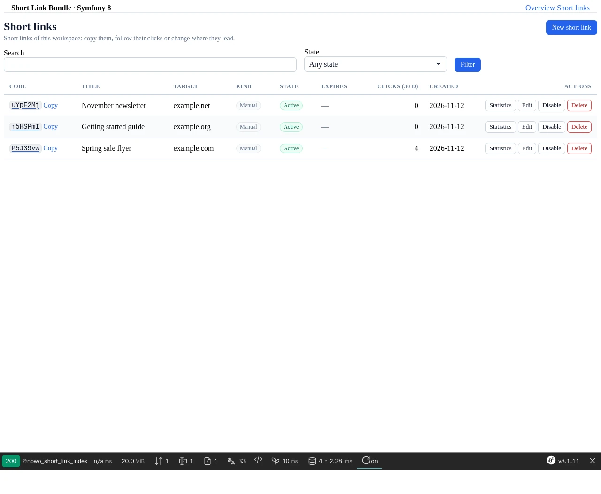

# Usage

## Table of contents

- [Status](#status)
- [Creating and managing links](#creating-and-managing-links)
- [Generated links (e-mail sends)](#generated-links-e-mail-sends)
- [Errors](#errors)
- [Events](#events)
- [Ports for multi-tenant and DDD hosts](#ports-for-multi-tenant-and-ddd-hosts)
- [Management UI](#management-ui)
- [Redirect path and firewalls](#redirect-path-and-firewalls)

## Status

S1–S4: the PHP API (manager, ports, persistence), the public redirect with its click log, statistics and retention, and
the management UI ([ROADMAP.md](ROADMAP.md)); the full design is [CONTRACT.md](CONTRACT.md) §3.

## Creating and managing links

```php
use Nowo\ShortLinkBundle\Domain\Model\{CreateShortLink, ShortLinkListQuery, TenantKey, UpdateShortLink};
use Nowo\ShortLinkBundle\Domain\Service\ShortLinkManagerInterface;

public function __construct(private ShortLinkManagerInterface $links) {}

$tenant = TenantKey::default();                       // multi-tenant hosts: TenantKey::fromString($organizationUuid)
$link   = $this->links->create($tenant, new CreateShortLink(
    'https://example.com/landing?utm_source=flyer',
    customCode: 'launch-2026',                         // null = random base62 code of 7 characters
    title: 'Launch flyer',
    expiresAt: new \DateTimeImmutable('+90 days'),
));
$link->shortUrl;                                       // https://your.host/s/launch-2026

$this->links->update($tenant, $link->id, new UpdateShortLink('https://example.com/new', 'Launch flyer'));
$this->links->disable($tenant, $link->id);             // the redirect answers 404
$this->links->enable($tenant, $link->id);              // the target is guarded again
$this->links->delete($tenant, $link->id);              // tombstone: the code stays taken for code.quarantine

$page = $this->links->list($tenant, new ShortLinkListQuery(search: 'flyer', limit: 25));
$next = $this->links->list($tenant, new ShortLinkListQuery(limit: 25, after: $page->next));
```

Every method takes the tenant explicitly; another tenant's id answers as missing. Links of a kind counted by the plan
limit (`manual` by default) must be created outside an open database transaction (the tenant lock has to cover the
commit); `email` links are not counted and may be created inside one. `list()` returns only the kinds shown in the UI;
programmatic callers pass `new ShortLinkListQuery(kind: LinkKind::email(), system: true)`. Codes are immutable (a new code is a
new link). Custom codes are lowercased; random codes are case-sensitive (`aB3xY9k` and `AB3XY9K` are two links).

## Generated links (e-mail sends)

```php
use Nowo\ShortLinkBundle\Domain\Model\{LinkKind, LinkSource};

$views = $this->links->createMany($tenant, [
    new CreateShortLink('https://example.com/a', kind: LinkKind::email(), source: new LinkSource($sendId, 'Header logo', 0), system: true),
    new CreateShortLink('https://example.com/b', kind: LinkKind::email(), source: new LinkSource($sendId, 'Button', 1), system: true),
]);
```

At most 200 commands, one transaction, random codes only. A command whose (kind, send ref, position) already has a live
link returns that link: a retried send never duplicates links. `email` links never count against the plan limit and
are hidden from the default list. `system: true` skips the access check: set it only in programmatic callers, never from
request input.

## Errors

All implement `Nowo\ShortLinkBundle\Domain\Exception\ShortLinkExceptionInterface`:

| Exception | When |
| --- | --- |
| `TargetRefusedException` (`->refusal`: `Scheme`, `Userinfo`, `Length`, `PrivateHost`, `Metadata`, `Unresolvable`, `Denylisted`, `SelfLoop`) | The target cannot be used |
| `CodeTakenException` / `CodeReservedException` | The custom code is not available (same neutral message for taken, reserved and quarantined codes) |
| `CodeAttemptsExceededException` | The caller tried too many custom codes (`code.custom_code_rate_limit`, per tenant + actor); no custom code is looked up until the window ends (`system` commands are never limited) |
| `QuotaExceededException` (`->limit`) | The tenant's plan limit for a counted kind is reached |
| `AccessDeniedException` | The access port refused the action |
| `ShortLinkNotFoundException` | No live link with this id in this tenant |
| `InvalidShortLinkArgumentException` | A value broke its rule (expiry in the past, unknown kind, custom code where not allowed, batch over 200, …) |

## Events

Dispatched after the outermost commit (never when it rolls back), with ids and value objects only:
`ShortLinkCreatedEvent`, `ShortLinkUpdatedEvent`, `ShortLinkStateChangedEvent`, `ShortLinkDeletedEvent` and
`ShortLinkTargetRefusedEvent` (target host only, never the full URL), in `Nowo\ShortLinkBundle\Domain\Event`. They are
plain classes: listen to them by class name.

## Ports for multi-tenant and DDD hosts

| Port (`Nowo\ShortLinkBundle\Domain\Port`) | Default | Configure |
| --- | --- | --- |
| `ShortLinkTenantContextInterface` | single tenant `default` | `tenancy.context` |
| `ShortLinkAccessInterface` | `access.view_role` / `access.manage_role` (anonymous denied) | `access.provider` |
| `ShortLinkQuotaInterface` | `quota.default_limit` | `quota.provider` |
| `TargetDenylistInterface` | `target.denylist.hosts` | `target.denylist.provider` |
| `TargetGuardInterface` | self chain + OutboundUrlGuard + denylist | `target.guard: <service id>` |
| `ReservedCodeProviderInterface`, `CodeBlocklistInterface`, `ShortLinkIdGeneratorInterface`, `TenantLockInterface` | built in | decorate the alias |

Ports take and return the bundle's value objects only (no Symfony, Doctrine or HTTP types). Implementations must read
their request state on every call (FrankenPHP worker mode).

## Statistics

```php
use Nowo\ShortLinkBundle\Domain\Model\{ClickDimension, DateRange};
use Nowo\ShortLinkBundle\Domain\Service\ShortLinkStatsReaderInterface;

$range = DateRange::lastDays(30, new \DateTimeImmutable());
$stats->daily($tenant, $id, $range);                                   // list<DailyClicks>, zeros included
$stats->breakdown($tenant, $id, ClickDimension::Referrer, $range, 10); // top referrer hosts (~other beyond top N)
$stats->totals($tenant, [$id1, $id2]);                                 // one grouped read per table
$stats->bySource($tenant, LinkKind::email(), $sendId);                 // e-mail log: per link, label, position
```

Human and machine clicks (bots, link previews, e-mail scanners) are always apart. Rolled days come from the daily
rollup, the others from the raw clicks, so the numbers are exact before the rollup runs. The reader does not check
access: check `View` yourself.

## Maintenance commands

Schedule them daily (the bundle ships no scheduler), in this order:

| Command | Does |
| --- | --- |
| `nowo:short-link:rollup [--max-days=400]` | Rolls raw clicks into the daily table (the last `rollup.lag_days` days again); idempotent. With symfony/lock runs are serialised (TTL 3600 s); the default `flock` store does that on one host only: use a shared lock store for a multi-host schedule |
| `nowo:short-link:purge` | Deletes raw clicks of rolled days older than `click_log.retention`, rollups older than `click_log.rollup.retention`, tombstones older than `code.quarantine` |
| `nowo:short-link:recheck [--batch=500] [--dry-run]` | Re-runs the save guard (DNS included) over active links; refused ones are disabled (`recheck_refused`) with `ShortLinkStateChangedEvent` + `ShortLinkTargetRefusedEvent`, only if still unchanged. Unresolvable targets are skipped with a warning; once `target.recheck_min_sample` links were checked, more than `target.recheck_max_unresolvable_percent` of all checked targets unresolvable aborts the run (exit 1; `0` = on any), after the batch's other refusals were applied |

## Personal data (GDPR)

See [PRIVACY.md](PRIVACY.md). `ShortLinkEraserInterface`: `eraseTenant()` (links turned into blanked tombstones of the tenant `~erased`, then
clicks and rollups deleted: the codes stay taken until the quarantine ends), `eraseSource()` (a send's links blanked
and tombstoned, then its clicks and rollups deleted), `anonymiseActor()` (`created_by` / `updated_by` set to null) and
`exportSource()` (`links`: the send's links with target, title and creation time; `clicks`: one row per stored click;
`daily`: the rollup rows of the send's links). The eraser
dispatches no `ShortLinkDeletedEvent`. Clicks that arrive after an erasure (queued Messenger messages) are dropped. Clicks hold no raw IP, no full User-Agent and no cookie.

## Redirect path and firewalls

Import the route (outside any locale prefix):

```yaml
# config/routes/nowo_short_link.yaml
nowo_short_link_redirect:
    resource: '@NowoShortLinkBundle/Resources/config/routes/redirect.php'
```

`GET|HEAD {redirect.path_prefix}/{code}` (default `/s/{code}`) is a public, unversioned protocol path (a link printed on
paper). It is stateless (no session, no cookie): keep it out of stateful firewalls, e.g.

```yaml
security:
    firewalls:
        short_link:
            pattern: ^/s/
            stateless: true
            security: false
```

Answers: 302 (or 307) to the stored target; one neutral 404 for every other case (unknown, disabled, expired, deleted,
refused target, malformed code); 429 with `Retry-After` over the per-IP miss limit (and over the hit limit with
`over_limit_hits: block`). Every answer sends `Cache-Control: no-store, private`, `Referrer-Policy: no-referrer`,
`X-Robots-Tag: noindex, nofollow` and `X-Content-Type-Options: nosniff`. Override the page with
`@NowoShortLink/redirect/not_found.html.twig` (or `redirect.not_found_template`); it receives `status` (404 or 429).

The limiters key on `Request::getClientIp()`: an IPv4 address (IPv4-mapped and 6to4 addresses fold to it) or the IPv6
network of `redirect.rate_limit.ipv6_prefix` bits (default /64, since one subscriber usually owns a whole /64).
Trade-offs: people behind one NAT or carrier-grade NAT share an IPv4 budget (this is why a valid link over the hit limit
still redirects by default, only unlogged); `framework.trusted_proxies` must list your real proxies only, or a spoofed
`X-Forwarded-For` gives every request a fresh budget, and if it is left empty behind a proxy every visitor shares the
proxy's budget. Give `redirect.rate_limit.cache_pool` a fast shared pool (Redis, APCu).

A refused target's `ShortLinkTargetRefusedEvent` and its warning are handled on `kernel.terminate`, after the 404 is
sent. Listener and log-handler failures on the redirect path (click event, refused event, recorder, Messenger bus) are
caught and logged with their class only: they never change the answer or stop a FrankenPHP worker.

Clicks are written after the response by default (`click_log.write: terminate`); `messenger` dispatches
`Nowo\ShortLinkBundle\Infrastructure\Messenger\RecordShortLinkClick` (route it to a transport, or it is handled at once);
`sync` writes before answering. HEAD requests are never logged.

## Management UI

Opt-in (`ui.enabled: true`, needs `NowoUiKitBundle` + `NowoFormKitBundle`, forms, sessions and Twig). Import the routes
under your own prefix:

```yaml
# config/routes/nowo_short_link.yaml
nowo_short_link_ui:
    resource: '@NowoShortLinkBundle/Resources/config/routes/ui.php'
    prefix: /organizations/{uuid}            # optional; then nowo_short_link.ui.tenant_route_parameter: uuid
```

| Route | Method | Path (under `ui.path_prefix`) | Permission |
| --- | --- | --- | --- |
| `nowo_short_link_index` | GET | `` (`?q=&state=&after=`) | View |
| `nowo_short_link_new` | GET, POST | `/new` | Manage |
| `nowo_short_link_edit` | GET, POST | `/{id}/edit` | Manage |
| `nowo_short_link_disable` / `_enable` / `_delete` | POST + CSRF | `/{id}/disable` … | Manage |
| `nowo_short_link_stats` | GET | `/{id}/stats?from=&to=` | View |
| `nowo_short_link_stats_csv` | GET | `/{id}/stats.csv?from=&to=&dimension=&excel=1` | View |

- The tenant comes from `ShortLinkTenantContextInterface` (none → 404); `ShortLinkAccessInterface` decides (denied →
  403, which your firewall turns into a login for anonymous visitors). Another tenant's id answers 404.
- The forms are Symfony Form Types on the FormKit profile `short_link`, rendered with `form_start` / the child loop with
  `` / `form_end` (REQ-TWIG-005); host overrides must not reintroduce raw `<form>` or
  `<input>` markup. They never map `system` or `kind`: people create `manual` links (kinds with `show_in_ui: true`
  are listed).
- Disable, enable and delete are POST only, with one CSRF token per action (`nowo_short_link_<action>`); a missing or
  wrong token answers 403 and changes nothing.
- A custom code that is taken, reserved or quarantined answers "This code is not available." for every reason. Every
  custom-code lookup counts against `code.custom_code_rate_limit` (per tenant + actor, taken before the lookup); over
  the limit the form refuses custom codes for the rest of the window. Callers the access port does not identify share
  one window per tenant; replace `CustomCodeLimiterInterface` to key them by session or network.
- `ui.tenant_route_parameter` only builds URLs: it copies the `{uuid}` of the current request into the UI links. It
  never chooses the tenant. Your `ShortLinkTenantContextInterface` must resolve the tenant from that parameter **and**
  check the current user may act in it (or derive it from the session); the access port then authorises View / Manage
  in that tenant.
- Links of kinds with `show_in_ui: false` (e-mail links) are neither listed nor reachable by id: every page and action
  answers 404 for them.
- The search matches the code, title and target host case-insensitively (on SQLite only ASCII letters fold).
- The list reads at most 4 queries per page (links, then the 30-day click totals); the clicks column counts people,
  machine traffic is in the cell title.
- Pages, blocks and view models: [TEMPLATES.md](TEMPLATES.md). Translations: domain `NowoShortLinkBundle` (en, es,
  fr, it, pt, de, nl); add `ui.kind.<kind>` for your own kinds.


